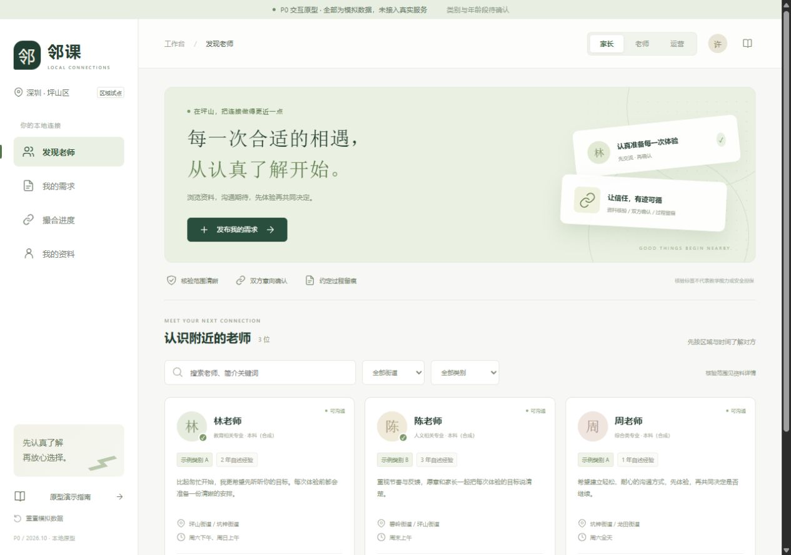

# 历史P0验收摘要

记录日期：2026-10-28；2026-11-07压缩整理。以下为原模拟原型当时的实测记录，**本次文档清理没有重新运行这些测试**，不能据此证明首版真实业务通过。

| 当时的检查 | 记录结果与限制 |
| --- | --- |
| frontend目录npm.cmd test | 10项模拟测试通过；不是真实API、权限、数据库或并发测试 |
| npm.cmd run build | 当时类型检查、Vite构建和单文件导出通过 |
| 本机HTTP与浏览器操作 | 发布/审核/投递/邀请/回应、模拟联系授权、驳回修订、快照、筛选、刷新/重置可演示 |
| 手机/桌面断点 | 当时检查390×844与1280×900，无整体横向溢出；不是实机或完整无障碍验证 |
| 预约分支 | 仅旧原型提议/双方确认演示，现首版已延期，不要求按原路线开发 |
| file协议 | 内置浏览器限制访问，未进行直接双击HTML模式实测 |

原型位置：[App.vue](../../frontend/src/App.vue)、[domain.ts](../../frontend/src/domain.ts)、[模拟测试](../../frontend/tests/flows.test.mjs)。运行命令见[项目说明](../../README.md)。当前规格另见[首版规则](../mvp-spec.md)，待执行真实验收另见[核心清单](mvp-cases.md)。

两张原合成截图保留作为当时的视觉记录，不是当前Figma或新规则的证据：

